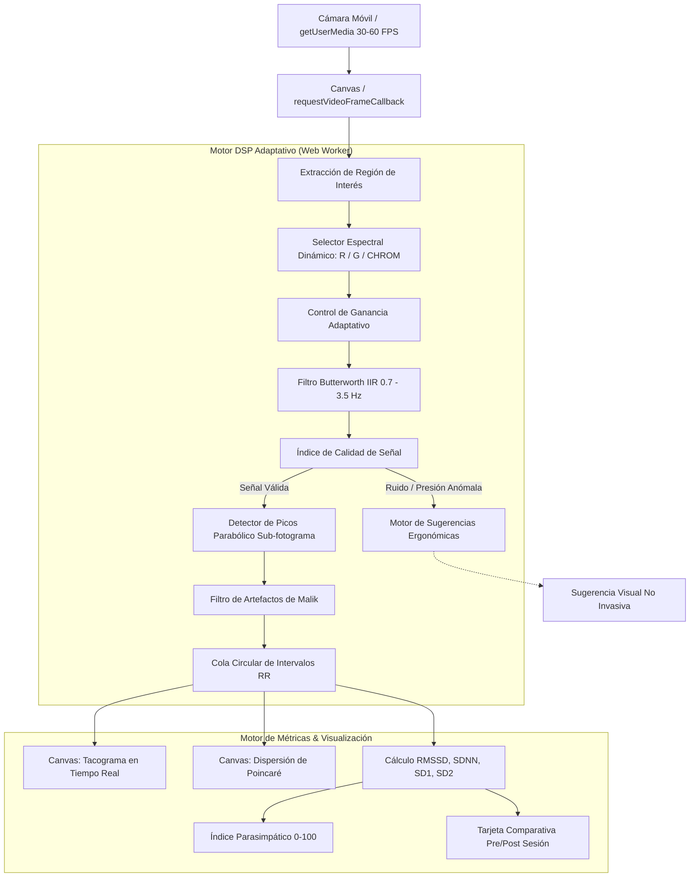

# VFC Monitor (Variabilidad de la Frecuencia Cardíaca & Cardiotacograma)

*   **Author:** Antigravity & User
*   **Status:** Approved
*   **Date:** 2026-11-06
*   **Design Craft Standard:** Impeccable (OLED Obsidian & Sage - Modo Experiencia & Operación Serena)

--------------------------------------------------------------------------------

## Overview

VFC Monitor es una Progressive Web App (PWA) móvil para Android, diseñada para medir la Variabilidad de la Frecuencia Cardíaca (VFC / HRV) y proyectar el cardiotacograma en tiempo real mediante la cámara del celular.

Su propósito central es doble:
1. **Monitoreo Somático en Masaje y Terapias Corporales:** Monitoreo no invasivo de la transición desde la sobreactivación simpática hacia el estado de calma y recuperación parasimpática (tono vagal / modelo polivagal).
2. **Pedagogía y Docencia Universitaria:** Demostración visual de la Arritmia Sinusal Respiratoria (RSA), intervalos interlatido (IBI / RR) y el elipsoide de dispersión de Poincaré.

## The Problem

Los terapeutas corporales, masajistas y docentes universitarios que desean medir la respuesta autonómica se enfrentan a tres barreras:
1. **Dependencia de Hardware Dedicado:** Sensores clínicos de ECG o bandas pectorales Bluetooth (ej. Polar H10) son costosos, intimidantes para el paciente en una camilla de masaje y complejos de configurar en clases prácticas.
2. **Falta de Adaptabilidad Anatómica:** La mayoría de apps comerciales de fotopletismografía (PPG) asumen exclusivamente un dedo colocado sobre el flash. En una sesión de masaje, el terapeuta puede necesitar evaluar el pulso en la arteria carótida (cuello), la arteria radial (muñeca), la sien, el lóbulo de la oreja o el rostro (rPPG sin contacto) cuando el paciente se encuentra en relajación profunda.
3. **Pobreza de Señal y Latidos Falsos:** Zonas con menor lecho capilar producen una relación señal-ruido muy baja. Las herramientas convencionales procesan el ruido como si fueran latidos cardíacos, arrojando valores de VFC completamente distorsionados.

VFC Monitor resuelve este problema mediante un **motor fotopletismográfico universal y adaptativo**: control de ganancia automático (AGC), conmutación espectral dinámica (R/G/CHROM), detección de picos sub-fotograma (<2 ms de resolución efectiva a 30 FPS) y un índice de calidad de señal (SQI) en tiempo real con sugerencias ergonómicas.

## Goals

*   **G-1 (PWA Móvil en Android Chrome):** Ejecutable directamente en el navegador del teléfono con soporte de antorcha (`torch: true`) y Wake Lock para evitar suspensión de pantalla.
*   **G-2 (Adquisición Universal en Cualquier Zona Anatómica):** Soporte automático para dedo, lóbulo de la oreja, cuello/carótida, muñeca, o rostro (rPPG frontal) con selección dinámica de canal espectral (Rojo vs. Verde vs. CHROM).
*   **G-3 (Control de Ganancia Adaptativo - AGC):** Extracción de la micro-oscilación pulsátil incluso en zonas con relación AC/DC menor al 0.2%.
*   **G-4 (Superación de la Cuantización a 30 FPS):** Interpolación parabólica sub-fotograma en el ápice de la onda para alcanzar una resolución efectiva $< 2\text{ ms}$ en los intervalos RR.
*   **G-5 (Semáforo de Calidad SQI con Sugerencias Inteligentes):** Detección continua de ruido o presión inadecuada con pausas preventivas del tacograma para evitar registrar datos falsos.
*   **G-6 (Visualizaciones Fisiológicas Didácticas):**
    - Tacograma continuo en tiempo real (RR ms vs. tiempo) renderizado en Canvas a 60 FPS.
    - Gráfico de dispersión de Poincaré ($RR_n$ vs. $RR_{n+1}$) con elipsoide de tono vagal ($SD1, SD2$).
    - Índice Parasimpático Unificado (0 a 100) calibrado log-sigmoide.
    - Comparativa interactiva Pre vs. Post masaje (Delta de Recuperación Autonómica).
*   **G-7 (Estética Serena Impeccable):** Paleta *OLED Obsidian & Sage* (`#070A09`, `#689D84`, `#D4A373`) libre de destellos o alertas estresantes para la penumbra del masaje.

## Non-Goals

*   **NG-1 (Dispositivo Médico de Diagnóstico):** No diagnostica arritmias, isquemias ni patologías cardíacas. Se cataloga como herramienta de biofeedback de relajación, bienestar y docencia.
*   **NG-2 (Grabación Continua de 40 Minutos con Flash):** El flash LED continuo se limita a tomas de calibración de 60 a 120 segundos para evitar calentamiento térmico en la piel.
*   **NG-3 (Soporte de Flash en iOS Safari):** El navegador Safari de Apple bloquea por sandbox la API de linterna (`torch`). En iOS opera exclusivamente en modo rPPG facial.

## Critical User Journeys (CUJs)

### CUJ 1: Medición Pre y Post Masaje en Camilla
*   **Given**: Un paciente se recuesta en la camilla para una sesión de masaje polivagal.
*   **When**: El masajista abre la webapp en su móvil, coloca el sensor en el dedo o en la arteria carótida del cuello durante 60 segundos de calibración basal inicial, realiza el tratamiento, y vuelve a registrar 60 segundos al finalizar.
*   **Then**: La aplicación compara ambas tomas y proyecta una tarjeta didáctica: *"Tono Parasimpático aumentó de 38 a 76 (+100%). Dispersión de Poincaré ensanchada favorablemente"*.

### CUJ 2: Clase Universitaria de Fisiología / Arritmia Sinusal Respiratoria
*   **Given**: Un docente proyecta la webapp móvil a una pantalla en el aula.
*   **When**: Un voluntario respira a 6 respiraciones por minuto (frecuencia de resonancia 0.1 Hz) mientras la cámara frontal captura su rPPG facial.
*   **Then**: El tacograma oscila en una onda sinusoidal rítmica de gran amplitud y el gráfico de Poincaré se expande, permitiendo explicar la modulación vagal del nódulo sinusal en vivo.

--------------------------------------------------------------------------------

## Technical Plan (Architecture)

### 1. Data Flow Pipeline

### 2. Component Breakdown

#### A. `CameraStreamer` (Gestión de Hardware y Antorcha)
- Invocación con `getUserMedia` solicitando `{ video: { facingMode: 'environment', frameRate: { ideal: 60, min: 30 } } }`.
- Activación de antorcha en Android Chrome mediante `track.applyConstraints({ advanced: [{ torch: true }] })`.
- Manejo del temporizador de protección térmica: tras 120s de medición continua con flash, emite una sugerencia sutil para evitar calentamiento.
- Gestión de `navigator.wakeLock` para mantener la pantalla activa.

#### B. `AdaptiveDspEngine` (Procesamiento Digital de Señal Universal)
- **Selector Espectral Inteligente:** Extrae los componentes de color $R, G, B$ promedio de la región de muestreo. Evalúa la prominencia espectral en la banda cardíaca $[0.7\text{ Hz}, 3.5\text{ Hz}]$ y conmuta automáticamente entre canal Rojo (contacto profundo con flash), canal Verde (contacto con luz ambiental / lóbulo) o algoritmo CHROM (rPPG facial).
- **Control de Ganancia Adaptativo (AGC):** Resta dinámicamente la componente continua $DC$ mediante un promedio exponencial móvil y normaliza por la desviación estándar $AC$, amplificando pulsaciones tenues en zonas como la muñeca o el cuello.
- **Filtro Pasabanda Butterworth:** Implementación IIR de 4to orden con frecuencias de corte en 42 BPM (0.7 Hz) y 210 BPM (3.5 Hz).
- **Interpolación Sub-Fotograma:** Ajuste de parábola de Lagrange de 3 puntos alrededor del pico detectado $y[n]$:
  $$\Delta t = \frac{y[n-1] - y[n+1]}{2(y[n-1] - 2y[n] + y[n+1])} \cdot T_s$$
  Proporciona una precisión de resolución en el tiempo $< 2\text{ ms}$, eliminando el jitter del muestreo de la cámara.

#### C. `SqiEngine` (Calidad de Señal y Sugerencias en Tiempo Real)
- Calcula la relación de potencia espectral en banda cardíaca vs. ruido de alta/baja frecuencia.
- Detecta saturación lumínica extrema ($R > 250$) o pérdida de contacto ($R < 15$).
- Emite sugerencias en lenguaje claro:
  - *"Presión excesiva: afloje suavemente el contacto."*
  - *"Perfusión baja: desplace el sensor hacia la pulsación arterial."*
  - *"Mano inestable: estabilice el apoyo del teléfono."*

#### D. `MetricsAndVisualization` (Interfaz Serena Impeccable)
- **Tacograma en Vivo (Canvas 2D):** Gráfico con ventana deslizante de los últimos 30 segundos de intervalos RR en milisegundos.
- **Gráfico de Poincaré Dinámico:** Mapea cada punto $(RR_n, RR_{n+1})$ con el eje diagonal de identidad y ajusta el elipsoide de dispersión donde el ancho transversal corresponde a $SD1 = \sqrt{0.5 \cdot \text{RMSSD}^2}$.
- **Índice Parasimpático Normalizado (0 a 100):**
  $$P_{raw} = 0.7 \cdot \ln(RMSSD + 1) + 0.3 \cdot \ln(SD1 + 1)$$
  $$\text{Índice} = \frac{100}{1 + e^{-1.8(P_{raw} - 3.2)}}$$
  Categorizado en cuatro estados: Simpático Agudo (0-25), Neutro (26-55), Calma Parasimpática (56-80), Tono Vagal Profundo (81-100).
- **Comparativa Pre/Post:** Almacena la línea de base y genera el informe comparativo final para el paciente o alumno.

--------------------------------------------------------------------------------

## Testing Strategy

*   **Test 1 (Interpolación Parabólica Sub-Fotograma):**
    - *Entrada:* Señal senoidal simulada a 30 Hz con pico en $t = 1005\text{ ms}$ (entre cuadros).
    - *Verificación:* El algoritmo calcula el pico con un error $< 2\text{ ms}$.
*   **Test 2 (Conmutación Espectral y AGC):**
    - *Entrada:* Señal con amplitud AC atenuada al 0.1% de DC (simulando muñeca/cuello).
    - *Verificación:* El AGC amplifica la señal sin saturación y extrae la frecuencia cardíaca con precisión $\pm 1\text{ BPM}$.
*   **Test 3 (Filtro de Calidad SQI):**
    - *Entrada:* Movimiento brusco simulado (ruido blanco de alta energía).
    - *Verificación:* El SQI transiciona a estado Rojo y el tacograma pausa la inserción de puntos erróneos.
*   **Test 4 (Cálculo Matemático de RMSSD y Poincaré):**
    - *Entrada:* Serie sintética de RR con arritmia respiratoria conocida.
    - *Verificación:* Los valores de RMSSD, SD1 y SD2 coinciden con los estándares de la *Task Force of the European Society of Cardiology*.
